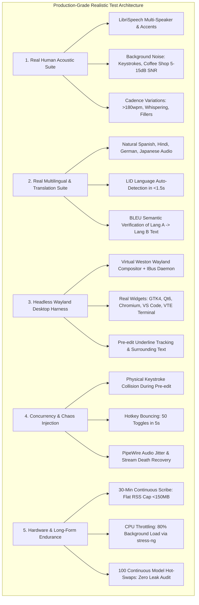

# Narad — Architecture

Companion to [REQUIREMENTS.md](REQUIREMENTS.md).

## 1. Overview

```
 ┌──────────────────────── GNOME Shell (Wayland) ────────────────────────┐
 │  narad@narad.dev extension  ("desktop bridge")                        │
 │   • floating HUD (anchor + companion pill; always on top, draggable) │
 │   • focused app id, PRIMARY selection, transient Esc grab             │
 │   • partial transcript listener for live companion feedback           │
 └───────────────┬───────────────────────────────────────────────────────┘
                 │ D-Bus (session bus)  dev.narad.Daemon
 ┌───────────────┴───────────────────────────────────────────────────────┐
 │  naradd  (Rust daemon, systemd user service)                          │
 │                                                                       │
 │  Hotkeys ── xdg-desktop-portal GlobalShortcuts                        │
 │  Audio   ── PipeWire capture → resample 16 kHz mono → 50ms chunks     │
 │  Pipeline:                                                            │
 │   ├─ VAD: Silero VAD + continuous silence failsafe                    │
 │   ├─ ASR: Polymorphic NaradAsrEngine (Online Zipformer / Chunked      │
 │   │       Moonshine & Whisper / Direct Lang A→B Translation)          │
 │   ├─ Context: AT-SPI2 screen inspector + IDE symbols + surrounding txt│
 │   ├─ Text: Zero-latency rules, commands, replacements, cleanup guard  │
 │   └─ Insert:                                                          │
 │       ├─ Primary: Native IBus Engine (live underlined pre-edit)       │
 │       └─ Fallback: Clipboard set + Ctrl+V via libei RemoteDesktop     │
 │  Store   ── SQLite + FTS5, audio spool (Opus), auto-learning dictionary│
 │  Agent   ── Local stdio/Unix Model Context Protocol (MCP) Server      │
 └───────▲──────────────────▲───────────────────────────────▲────────────┘
         │ D-Bus            │ D-Bus                         │ MCP (stdio/socket)
 ┌───────┴────────┐ ┌───────┴────────┐              ┌───────┴────────┐
 │ narad-dashboard│ │  narad (CLI)   │              │ Coding Agents  │
 │ Tauri v2 +     │ │                │              │ (Antigravity,  │
 │ Svelte         │ │                │              │  Claude, etc.) │
 └────────────────┘ └────────────────┘              └────────────────┘
```

Three processes, one contract (D-Bus interface), plus local agentic integration via MCP. The daemon owns all state and inference; the dashboard and CLI are thin clients. The GNOME extension is the only GNOME-specific piece, keeping core dictation and IBus engine logic portable across Wayland and X11 desktops.

## 2. Why these platform choices (GNOME 50 / Wayland)

| Need | Choice | Reason / rejected alternatives |
|---|---|---|
| Global hotkey with **hold** and **tap** | `org.freedesktop.portal.GlobalShortcuts` | Emits `Activated` *and* `Deactivated`, so push-to-talk works. GNOME custom keybindings only fire on press. Supported by xdg-desktop-portal-gnome ≥ 48. |
| Streaming inline text at cursor | Native IBus Input Method Engine (`org.freedesktop.IBus.Engine`) | Words appear underlined directly at the blinking cursor as spoken without simulated key-presses or clipboard clobbering. Supported natively across GTK, Qt, Chromium, and Electron apps. |
| Fallback text insertion (non-IBus / terminals) | Clipboard set + `Ctrl+V` / `Ctrl+Shift+V` via `org.freedesktop.portal.RemoteDesktop` (libei keyboard) | Used when IBus is absent or target app is a raw terminal without pre-edit support. `wtype` unsupported on GNOME. `ydotool` requires root/uinput setup. |
| Always-on-top floating HUD | GNOME Shell extension (`Main.layoutManager.addChrome`) | Wayland clients cannot position themselves or force always-on-top. XWayland hack is fragile. Circular ~28px anchor + companion waveform pill (Stitch Quiet Precision). |
| Focused app, selected text | Same extension (`global.display.focus_window`, `St.Clipboard` PRIMARY) | No portal exposes these. |
| Screen and UI context harvesting | AT-SPI2 Accessibility Bus (`org.a11y.Bus`) | Allows harvesting focused field text and surrounding words locally for vocabulary biasing without screenshots or cloud OCR. |
| Cancel with `Esc` | Extension adds a keybinding only while recording (**decision #4 locked**) | A permanent global `Esc` would break every app. Portal Esc shortcut is a non-GNOME fallback later. |

## 3. Components

### 3.1 `naradd` (daemon)

Rust, single binary, `tokio` runtime with dedicated inference threads.

| Module | Responsibility | Key crates / libs |
|---|---|---|
| `ipc` | D-Bus service `dev.narad.Daemon` (methods, signals, properties) | `zbus` |
| `hotkeys` | Portal session, bind shortcuts, hold/tap state machine | `ashpd` |
| `audio` | PipeWire capture, ring buffer, resample to 16 kHz mono f32, 50ms chunk pump | `pipewire` (or `cpal`), `rubato` |
| `denoise` | Optional RNNoise | `nnnoiseless` |
| `vad` | Silero VAD: real-time speech boundary, auto-stop, silence rejection | `sherpa-onnx` |
| `asr` | Polymorphic `NaradAsrEngine`: Online streaming (Zipformer), Chunked (Moonshine/Whisper), Direct Translation (Whisper Lang A→B) | `sherpa-onnx` |
| `ibus` | Native IBus IME Engine (`org.freedesktop.IBus.Engine`), live underlined pre-edit, cursor anchoring, surrounding-text receiver | `zbus` |
| `hardware`| CPU topology & SIMD profiler (AVX2/AVX-512/AMX), dynamic BYOM model manifest parser, thread tuning | pure Rust |
| `context` | AT-SPI2 accessibility crawler, active window tracker, IDE symbol harvester, dynamic hotword biasing | `zbus`, pure Rust |
| `text` | Voice commands, dictionary, replacements, code-case rules, hallucination filter | pure Rust |
| `translate`| MT pack runner / single-pass Whisper cross-lingual translator | `sherpa-onnx`, `ct2rs` |
| `cleanup` | LLM prompts per mode, grounding guard | `llama-cpp-2` (llama.cpp, GGUF) |
| `insert` | Fallback clipboard save/set/restore, paste keystroke via libei, terminal detection, undo | `ashpd`, `reis` |
| `store` | SQLite schema, FTS5 search, retention jobs, audio spool, auto-learning dictionary | `rusqlite` |
| `models` | Registry of installed packs, zero-downtime hot-swap (`arc_swap`), benchmark | `arc_swap` |
| `mcp` | Local stdio/Unix Model Context Protocol server for coding agents | pure Rust |
| `config` | TOML config, live reload | `serde`, `toml`, `notify` |

`sherpa-onnx` is the unified runtime for VAD, streaming ASR, offline chunked ASR, multilingual translation, wake-word spotting, and diarization.

### 3.2 GNOME extension (`extension/`)

GJS, ~350 lines. Draws the floating HUD (idle anchor; listening/processing companion pill), forwards clicks, reports focus changes and PRIMARY selection on request, grabs `Esc` during recording, and listens to `PartialTranscript` D-Bus signals for live waveform and text preview in the companion pill.

### 3.3 `narad-dashboard`

Tauri v2 + Svelte (small bundle, fast cold start). Talks to the daemon over D-Bus via a thin Rust command layer. Owns model downloads (the only network code in the system). Views: **History**, **Stats**, **Models**, **Settings**.

### 3.4 `narad` CLI

Rust, `clap`, shares the D-Bus client crate with the dashboard.

### 3.5 Local Agentic Integration (MCP)

Built-in Model Context Protocol server exposing daemon tools (`dictate`, `get_history`, `insert_jargon`, `set_active_model`) to local AI coding agents (Antigravity, Claude, Cursor) over stdio or local Unix domain socket.

## 4. Hot path: hotkey → text

### 4.1 Native Streaming Path (Primary: IBus Pre-Edit)

```
t0       hotkey Activated (portal)
         ├─ open PipeWire stream, play start cue, signal state=listening
         ├─ harvest AT-SPI2 screen context & IDE variables (async, cached)
         └─ attach IBus input context to active client window
t_stream (every 50ms audio chunk)
         ├─ VAD chunk check → push to OnlineRecognizer stream
         ├─ decode partial tokens (15–35ms latency on CPU)
         ├─ format punctuation & case heuristics
         ├─ IBus UpdatePreeditText (underlined preview directly at blinking cursor)
         └─ emit D-Bus PartialTranscript (updates floating HUD companion pill)
t1       hotkey Deactivated (hold release) | second tap | VAD auto-stop
         ├─ close stream, signal state=processing
         ├─ flush remaining audio frames through ASR stream
         ├─ apply voice commands → dictionary replacements → cleanup guard
         ├─ IBus CommitText (underlined preview locks into final text instantly)
         └─ IBus HidePreeditText
t2       write history row + async user-edit diff learner (off hot path)
         signal state=idle
```

### 4.2 Fallback Path (Terminals & Non-IBus Clients)

When the focused application does not support IBus input contexts (e.g. raw VTE terminals or legacy XWayland apps), the pipeline accumulates decoded text in memory and executes:
```
t1  Stop → VAD trim → ASR decode → text rules → save clipboard → set final text → Ctrl+V / Ctrl+Shift+V via libei → restore clipboard → state=idle
```

Latency rules:
- Models are resident in memory; never loaded on the hot path.
- In-memory 50ms chunk streaming avoids disk I/O before commit.
- History writes, audio spooling, and vocabulary self-learning run on dedicated background worker threads.
- Inference threads pinned to physical performance cores.

## 5. Data

Locations (XDG):

| Path | Content |
|---|---|
| `~/.config/narad/config.toml` | Settings, hotkeys, modes, per-app profiles |
| `~/.local/share/narad/narad.db` | History, dictionary, stats |
| `~/.local/share/narad/audio/` | Retained audio (`<entry-id>.opus`) |
| `~/.local/share/narad/models/<type>/<id>/` | Model packs + `manifest.toml` |
| `$XDG_RUNTIME_DIR/narad/spool/` | In-flight audio for crash recovery |

Core tables (sketch):

```sql
entries(id, created_at, duration_ms, mode, src_lang, dst_lang,
        asr_model, mt_model, llm_model, app_id,
        raw_text, final_text, insert_status, cleanup_flagged,
        audio_path, pinned)
entries_fts(raw_text, final_text)        -- FTS5, external content
tags(id, name);  entry_tags(entry_id, tag_id)
dictionary(id, kind /* vocab|replace|snippet */, spoken, written)
```

Model pack manifest (default English ASR — REQUIREMENTS §8 decision #1):

```toml
id = "parakeet-ctc-110m-int8"
type = "asr"            # asr | mt | llm | kws
runtime = "sherpa-onnx"
languages = ["en"]      # mt: pairs = [["en","hi"]]
size_mb = 126           # on-disk pack dir on reference machine; verify on install
sha256 = "…"
files = ["model.int8.onnx", "tokens.txt"]
# Other packs (e.g. Parakeet TDT 0.6B, Whisper) use different file sets; user-selectable in Phase 3.
```

## 6. D-Bus interface (sketch)

```
dev.narad.Daemon
  Methods:  Start(mode s) · Stop() · Cancel() · Toggle(mode s)
            PasteLast() · UndoLast() · SelectionCommand()
            Transcribe(path s, mode s, dst_lang s) → (id x)
            History(query s, offset u, limit u) → a(...)
            ReinsertEntry(id x) · DeleteEntries(ids ax)
            ListModels() · SetActiveModel(type s, id s) · Benchmark()
  Signals:  StateChanged(state s)           # idle|listening|processing|error|copied
            Level(rms d)                    # ~30 Hz while listening
            EntryAdded(id x)
  Properties: Mode s · Paused b · HudVisible b
```

## 7. Repository layout (planned)

```
narad/
  Cargo.toml              # workspace
  crates/
    naradd/               # daemon
    narad-core/           # pipeline, text rules, store (platform-agnostic)
    narad-dbus/           # shared D-Bus client/types
    narad-cli/
  dashboard/              # Tauri v2 + Svelte
  extension/              # GNOME Shell extension
  packaging/              # systemd unit, RPM spec
  docs/
```

`narad-core` has no Linux/GNOME dependencies so it can be reused on other platforms; platform specifics live in `naradd` behind traits (`HotkeySource`, `Inserter`, `DesktopBridge`).

## 8. Architectural Decision Records (ADRs)

### ADR-001: Native IBus Pre-Edit Engine vs. Simulated Keystroke/Clipboard Paste
- **Context:** Wispr Flow and legacy dictation tools rely on simulated `Ctrl+V` / `Cmd+V` clipboard pastes. This clobbers the user's system clipboard, disrupts web applications (e.g. Monaco editor in VS Code, Slack message boxes, Google Docs), and prevents users from seeing words appear live as they speak.
- **Decision:** Implement a native Linux Input Method Engine (`org.freedesktop.IBus.Engine`). Partial transcription tokens are emitted directly to the active application context via `UpdatePreeditText`, displaying an underlined inline preview at the blinking cursor. Upon utterance end or natural pause, text is atomically locked in via `CommitText`.
- **Fallback:** If an application lacks an active IBus context (e.g. raw VTE terminals or legacy XWayland applications), the daemon gracefully falls back to clipboard paste via the RemoteDesktop portal (`libei`).
- **Consequences:** Eliminates clipboard race conditions, provides immediate visual feedback, works identically across Wayland and X11, and delivers lower latency than simulated keystroke injection.

### ADR-002: Polymorphic Universal BYOM ASR Dispatcher & Hardware Profiler
- **Context:** Users require running diverse ASR models matched to their hardware capabilities (from ultra-low-power Zipformer int8 on 4-thread CPUs to Whisper large or Moonshine on AVX-512 / GPU workstations), plus cross-lingual translation (Lang A → Lang B). Hardcoding a single model architecture blocks model diversity.
- **Decision:** Introduce a polymorphic `NaradAsrEngine` trait with three execution modes:
  1. **True Online Streaming:** Driven by `sherpa_onnx::OnlineRecognizer` for Zipformer Transducer/CTC models (sub-35ms token latency).
  2. **Sliding-Window Chunked Pseudo-Streaming:** Driven by `sherpa_onnx::OfflineRecognizer` for Moonshine and Whisper models with overlapping 500ms sliding windows.
  3. **Direct Single-Pass Multilingual Translation:** Driven by Whisper offline translation mode (`task = "translate"`), decoding directly from source speech in Language A to target text in Language B.
  A runtime hardware profiler checks CPU SIMD flags (AVX2, AVX-512, AMX), cache topology, and memory bandwidth, dynamically tailoring thread allocations and recommending model tiers.
- **Consequences:** Enables universal Bring-Your-Own-Model (BYOM) folder drops with automatic `manifest.toml` generation while maximizing CPU efficiency.

### ADR-003: Transactional Zero-Downtime Hot-Swapping via `ArcSwap`
- **Context:** In traditional architectures, changing models in settings requires stopping the daemon, causing dropped audio frames, UI disconnects, and hotkey unregistration.
- **Decision:** Wrap the active inference engine in `arc_swap::ArcSwapOption<Box<dyn NaradAsrEngine>>`. Background threads load and verify new model weights into RAM. Once verified, an atomic pointer swap replaces the resident engine with zero lock contention. In-flight utterances finish processing on the old engine instance before it is dropped.
- **Consequences:** Zero-downtime model switching; audio recording and hotkey pipelines continue uninterrupted.

### ADR-004: Local Desktop Accessibility (AT-SPI2) & Surrounding-Text Context Harvesting
- **Context:** Wispr Flow achieves high transcription accuracy by harvesting accessibility trees (`ax_context`), screen OCR, and IDE symbol names. Replicating this via cloud transmission would violate Narad's core local-only privacy contract.
- **Decision:** Harvest context 100% locally on-device:
  1. Inspect the focused application's accessibility tree via AT-SPI2 D-Bus (`org.a11y.Bus`) to retrieve input field roles and visible text labels.
  2. Query IBus surrounding-text context via `SetSurroundingText` to detect preceding punctuation, sentence capitalization, and spacing.
  3. Scan active project directories for code identifiers and variable names.
  Harvested tokens are loaded directly into Sherpa-ONNX's in-memory dynamic hotword biasing table (`OnlineRecognizer::create_stream_with_hotwords`). Zero pixels, audio, or text leave the device.
- **Consequences:** Delivers context-aware dictation accuracy matching or exceeding Wispr Flow while maintaining a zero-cloud, 100% private security boundary.

### ADR-005: Local Model Context Protocol (MCP) Server
- **Context:** Modern coding environments are driven by autonomous AI agents (Antigravity, Claude, Cursor) that need seamless access to dictation, history, and voice-command operations.
- **Decision:** Embed a native stdio and Unix domain socket Model Context Protocol (MCP) server directly inside `naradd`. Agents can query transcription history, inject domain vocabulary, inspect current engine status, and trigger dictation flows.
- **Consequences:** Positions Narad as the primary voice interface for autonomous AI coding agents.

---

## 9. Single Source of Truth (SSoT) Architecture & Documentation Governance

To guarantee that documentation remains synchronized with implementation and prevent architectural drift, contradictory claims, or multiple sources of truth across coding sessions, the project enforces a strict governance protocol:

```
Authority Ladder:
1. Human Turn Instruction (highest precedence)
2. Normative Intent: docs/REQUIREMENTS.md (FR/NFR), docs/ARCHITECTURE.md (ADR), docs/ROADMAP.md (Phase), PRODUCT.md
3. Ground Truth: Code + Unit/Integration Tests + Git History
4. Structural Map: Graphify Extracted Edges (source-verified)
5. Descriptive Prose: Design tours, old plans, READMEs (Hint only)
```

### Anti-Drift Protocol (`DRIFT: <doc> vs <file:line>`)
1. **Code Wins:** When narrative prose contradicts running code and tests, code is the factual authority.
2. **Explicit Drift Reporting:** Agents discovering discrepancies between code and documentation must emit:
   `DRIFT: <doc-path> vs <file:line>`
3. **Synchronous Normative Updates:** When an implementation slice adds, expands, or modifies a behavioral seam, the corresponding normative documents (`docs/REQUIREMENTS.md`, `docs/ARCHITECTURE.md`, `docs/ROADMAP.md`) must be updated within the **same commit slice**.
4. **Single Source Rule:** Requirements must never be duplicated with conflicting wording across different documents. `REQUIREMENTS.md` owns functional requirements (FR) and non-functional requirements (NFR); `ARCHITECTURE.md` owns architectural decisions (ADR) and component contracts; `ROADMAP.md` owns phase boundaries.

---

## 10. Production-Grade Realistic Testing Architecture

> [!IMPORTANT]
> Synthetic sine waves (`tone440`) and zero-byte audio buffers only verify internal plumbing. Surpassing Wispr Flow requires a rigorous test suite reflecting real human speech acoustics, ambient noise, multi-language speech, headless desktop widgets, and concurrency chaos.



### 10.1 Real Human Acoustic Corpus & Realistic Noise Injection
- **Curated Multi-Speaker Corpora:** Automated test runs consume acoustic fixtures from LibriSpeech (clean and other splits) and Common Voice, spanning diverse accents (General American, British, Indian, accented European, Asian English).
- **Acoustic Noise Mixing:** Test fixtures programmatically mix human speech with real recorded background soundscapes (office chatter, mechanical keyboard clatter, coffee shop noise) at calibrated Signal-to-Noise Ratios (5 dB, 10 dB, 15 dB SNR).
- **Cadence & Prosody Stress:** Tests validate recognition against rapid speech (>180 wpm), whispered utterances, trailing murmurs, and natural hesitation fillers (*"um... uh... let me check"*).
- **Regression Gates:** Enforces Word Error Rate (WER) regression ceilings and strict Real-Time Factor (RTF $\le 0.05\times$) on CPU.

### 10.2 Real Multilingual & Cross-Language Translation Verification
- **Natural Spoken Corpora:** Audio fixtures in Spanish (`es`), Hindi (`hi`), German (`de`), French (`fr`), and Japanese (`ja`).
- **Language Identification (LID) Precision:** Spoken language must be detected with $\ge 98\%$ accuracy within the initial 1.5 seconds of audio streaming.
- **Translation Fidelity Gate:** Translated text (e.g. spoken Spanish $\rightarrow$ written English) is scored against gold reference translations using BLEU and semantic sentence embeddings.

### 10.3 Live Headless Wayland Desktop Widget Test Harness
- **Virtual Weston Testbed:** Spawns a headless Wayland compositor (`weston --backend=headless`) and an isolated test IBus daemon instance (`IBUS_ADDRESS`).
- **Real Widget Targets:** Automated harness launches genuine client processes:
  - **GTK4:** `GtkEntry`, `GtkTextView` (GNOME Text Editor).
  - **Qt6:** `QLineEdit`, `QTextEdit` (KWrite).
  - **Chromium / Electron:** Web input elements, `contenteditable` (VS Code, Slack).
  - **VTE Terminal:** `gnome-terminal`, Alacritty (verifying pre-edit bypass and escape sequence isolation).
- **Surrounding-Text Capitalization & Spacing:** Asserts that cursor positioning after a period automatically triggers capitalization, and mid-sentence insertion properly handles leading/trailing spaces without clobbering existing text.

### 10.4 Concurrency, Chaos, & Keystroke Collision Injection
- **Physical Key Collision During Dictation:** While the ASR stream pushes partial pre-edit text, simulated physical keystrokes (`Backspace`, `Enter`, character typing) are injected into the client widget. The test asserts that pre-edit commits cleanly without dropped or out-of-order characters.
- **Hotkey Bouncing:** Tests rapidly toggle dictation 50 times in 5 seconds to guarantee absence of thread deadlocks, pipe leaks, or orphaned async tasks.
- **PipeWire Audio Chaos:** Tests simulate audio sink restart and ring buffer dropouts, verifying automatic stream reconnect without daemon crash.

### 10.5 Hardware Spec, Memory Leak, & Long-Form Endurance Auditing
- **30-Minute Continuous Scribe Endurance Run:** Continuous audio streaming through the chunked session engine must maintain a strictly bounded process RSS footprint ($\le 150$ MB RAM), proving zero heap accumulation.
- **CPU Throttling Stress:** Dictation pipeline is executed under 80% synthetic background CPU load (`stress-ng --cpu 4 --cpu-load 80`), verifying audio buffer integrity and sub-100ms commit latency.
- **100-Cycle Model Hot-Swap Audit:** Iterates 100 consecutive model swaps across Zipformer, Moonshine, Whisper, and Parakeet, asserting that heap allocations return precisely to baseline with zero dangling ONNX Runtime sessions.

---

## 11. Expanded D-Bus & MCP Interface Specification

```
dev.narad.Daemon
  Methods:
    Start(mode s) · Stop() · Cancel() · Toggle(mode s)
    PasteLast() · UndoLast() · SelectionCommand()
    Transcribe(path s, mode s, dst_lang s) → (id x)
    History(query s, offset u, limit u) → a(...)
    ReinsertEntry(id x) · DeleteEntries(ids ax)
    ListModels() · SetActiveModel(type s, id s) · Benchmark()
    SetSurroundingText(before s, after s)
  Signals:
    StateChanged(state s)           # idle|listening|processing|error|copied
    Level(rms d)                    # ~30 Hz while listening
    PartialTranscript(partial s)    # Emitted per 50ms chunk for HUD preview
    EntryAdded(id x)
  Properties:
    Mode s · Paused b · HudVisible b · ActiveEngine s · TargetLanguage s

dev.narad.Mcp (Local Model Context Protocol Server)
  Tools:
    narad_dictate(action: "start"|"stop"|"cancel", mode?: string)
    narad_get_history(query?: string, limit?: number)
    narad_add_vocabulary(spoken: string, written: string)
    narad_switch_model(model_id: string)
    narad_get_system_status()
```
