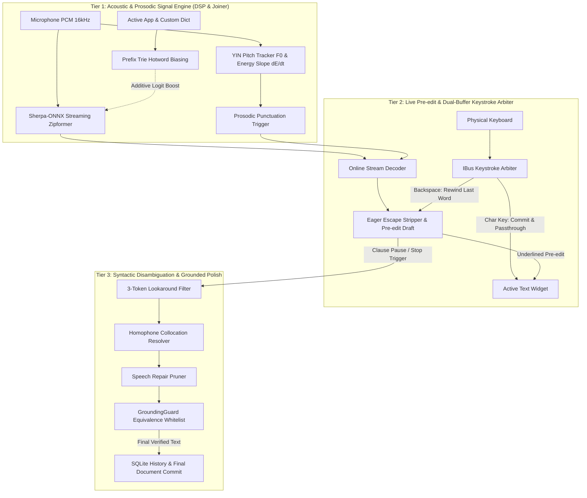
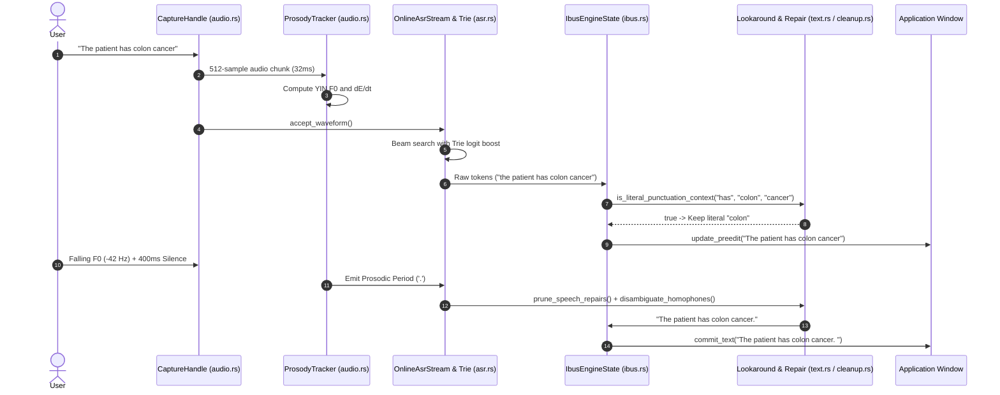

# Acoustic Prosody, Contextual Disambiguation, & Grounded Grammar Plan

- **Goal**: Implement an Apple-grade acoustic prosody engine (YIN $F_0$ pitch tracking, energy decay, prosodic auto-punctuation, Prefix Trie Joiner biasing) and deterministic syntactic disambiguation (3-token lookaround, homophone resolution, speech repair pruning, GroundingGuard whitelisting, dual-buffer typing) for streaming dictation.
- **Spec**: [`docs/superpowers/specs/2026-10-19-acoustic-prosody-and-contextual-disambiguation-design.md`](file:///home/sandy/projects/narad/docs/superpowers/specs/2026-10-19-acoustic-prosody-and-contextual-disambiguation-design.md)
- **Branch**: `native-streaming-dictation`
- **Worktree**: `/home/sandy/projects/narad`

---

## 1. Architectural Architecture & Dataflow



### 1.1 Sequence of Acoustic-Prosodic & Keystroke Pipeline



---

## Task 1: Syntactic Lookaround, Spoken Command Expansion & Code Mode Spacing (`crates/naradd/src/text.rs`)

### Description
1. In `crates/naradd/src/text.rs`:
   - Expand `Command` enum and `command_at`:
     - Add `Colon` (`"colon"`), `Semicolon` (`"semicolon"`), `Dash` (`"dash"`, `"hyphen"`), `EmDash` (`"em dash"`, `"long dash"`).
     - Add eager escape detection: if token is preceded by `"literal"` or `"word"`, suppress command conversion and emit literal text.
   - Implement `is_literal_punctuation_context(left: &[&str], punct_word: &str, right: &[&str]) -> bool`:
     - **Left Context**: Determiners (*"the"*, *"a"*, *"an"*, *"this"*, *"that"*, *"my"*, *"your"*, *"his"*, *"her"*), Prepositions (*"of"*, *"in"*, *"into"*, *"through"*, *"with"*, *"by"*), and Compound Modifiers (*"colonial"*, *"grace"*, *"100 meter"*) force literal word representation.
     - **Right Context**: Anatomical and compound nouns (*"cancer"*, *"tumor"*, *"surgery"*, *"polyps"*, *"screening"*, *"drama"*) force literal noun.
   - Implement `disambiguate_homophones(words: &[&str]) -> Vec<String>`:
     - Apply local POS bigram collocations:
       - *they're* before verbs (*"coming"*, *"going"*, *"here"*, *"ready"*).
       - *their* before nouns (*"car"*, *"house"*, *"code"*, *"idea"*, *"family"*).
       - *there* elsewhere (*"over there"*, *"there is"*, *"is there"*).
       - *cache* around storage/memory tokens (*"clear"*, *"memory"*, *"cpu"*, *"disk"*, *"l2"*, *"redis"*); *cash* around monetary terms (*"pay"*, *"money"*, *"bills"*, *"register"*).
   - Implement `format_mode_punctuation(text: &str, mode: &str) -> String`:
     - In `Code` mode, attach colons (`:`), semicolons (`;`), and dots (`.`) directly to the preceding word without spaces.
     - Format double colons (`::`) without inner whitespace (`std::collections`).
2. Unit tests in `crates/naradd/src/text.rs`:
   - Test *"colon cancer"* $\rightarrow$ *"colon cancer"* (not *": cancer"*).
   - Test *"literal colon"* $\rightarrow$ *"colon"*.
   - Test *"they're going to clean their room over there"*.
   - Test *"clear the cpu cache"* vs *"pay with cold hard cash"*.
   - Test `Code` mode spacing: `"std :: vector"` $\rightarrow$ `"std::vector"`.

### Deliverables & File Claims
- `crates/naradd/src/text.rs`

### Verification
```bash
cargo test -p naradd --lib text
```

---

## Task 2: Speech Repair Pruner & GroundingGuard Equivalence Whitelisting (`crates/naradd/src/cleanup.rs`)

### Description
1. In `crates/naradd/src/cleanup.rs`:
   - Implement `prune_speech_repairs(text: &str) -> String`:
     - Detect conversational speech repair backtrack markers:
       - *"no wait"*, *"wait no"*, *"actually no"*, *"sorry I meant"*, *"strike that"*, *"scratch that"*.
     - Isolate the repair marker:
       - Drop the abandoned left-hand clause back to the preceding clausal or punctuation boundary.
       - Preserve the corrected right-hand clause.
     - Example: *"meet at four no wait five pm"* $\rightarrow$ *"meet at five pm"*.
   - Update `GroundingGuard::check_grounding`:
     - Define homophone equivalence classes:
       - `{"there", "their", "they're"}`, `{"to", "too", "two"}`, `{"cache", "cash"}`, `{"hear", "here"}`, `{"its", "it's"}`.
     - In the novel-word check, treat substitutions between words within the same equivalence class as valid (novel count = 0).
     - Ensure that grammar and homophone corrections are never rejected by the guard.
2. Unit tests in `crates/naradd/src/cleanup.rs`:
   - Test repair pruning for single words and multi-word phrases.
   - Test `check_grounding` with homophone substitutions to ensure 0% rejection.
   - Test that malicious or hallucinated novel words are still caught and flagged.

### Deliverables & File Claims
- `crates/naradd/src/cleanup.rs`

### Verification
```bash
cargo test -p naradd --lib cleanup
```

---

## Task 3: Real-Time YIN $F_0$ Pitch Tracker & Energy Decay Estimator (`crates/naradd/src/audio.rs`)

### Description
1. In `crates/naradd/src/audio.rs`:
   - Implement `ProsodyTracker`:
     - Maintain an internal ring buffer of 16 kHz mono samples (frame size $W = 512$ samples / 32 ms).
     - Calculate Difference Function $d_t(\tau)$ for lag $\tau \in [32, 320]$ (50 Hz to 500 Hz human vocal range).
     - Calculate Cumulative Mean Normalized Difference Function (CMNDF) $d'_t(\tau)$.
     - Apply absolute dip threshold $\theta = 0.15$ with parabolic interpolation around $\tau^*$ to achieve sub-sample pitch precision $F_0 = \frac{f_s}{\tau^*}$.
     - Compute frame energy $E = 10 \log_{10}\left(\frac{1}{W} \sum x_i^2 + 10^{-12}\right)$.
     - Compute pitch delta $\Delta F_0 = F_0(t) - F_0(t - 150\text{ms})$ and energy slope $\frac{dE}{dt}$ via 5-point linear regression.
   - Expose `ProsodicEvent`:
     - `FallingIntonation` ($\Delta F_0 \le -35\text{ Hz}$ and $\frac{dE}{dt} < -0.10\text{ dB/ms}$)
     - `RisingIntonation` ($\Delta F_0 \ge +30\text{ Hz}$)
     - `LevelContinuation` ($\|\Delta F_0\| < 18\text{ Hz}$)
     - `Silence(Duration)`
2. Unit tests in `crates/naradd/src/audio.rs`:
   - Test pitch detection against synthetic 100 Hz, 220 Hz, and 440 Hz sine waves with $< 2\text{ Hz}$ error.
   - Test falling pitch classification on frequency sweep $200\text{ Hz} \rightarrow 130\text{ Hz}$.
   - Test rising uptalk classification on frequency sweep $180\text{ Hz} \rightarrow 250\text{ Hz}$.
   - Benchmark compute cost per 32 ms frame (< 0.2 ms CPU time, zero heap allocation in loop).

### Deliverables & File Claims
- `crates/naradd/src/audio.rs`

### Verification
```bash
cargo test -p naradd --lib audio
```

---

## Task 4: Dynamic Joiner Prefix Trie Biasing & Prosodic Punctuation Trigger (`crates/naradd/src/asr.rs`)

### Description
1. In `crates/naradd/src/asr.rs`:
   - Implement `ContextBiasingTrie`:
     - Trie data structure mapping uppercase BPE token sequences from `tokens.txt`.
     - Methods: `insert(phrase: &str, boost: f32)`, `step(&self, state: usize, token_id: i32) -> (usize, f32)`.
     - Provide dynamic population from active app profile, custom dictionary, and active window title.
   - Implement `ProsodicPunctuationTrigger`:
     - State machine combining `ProsodicEvent` from `ProsodyTracker` with pause duration:
       - Fall + silence $\ge 380\text{ ms} \implies$ auto-period (`.`) + capitalize next token.
       - Rise + silence $\ge 250\text{ ms} \implies$ auto-question mark (`?`) + capitalize next token.
       - Level + pause $160\text{–}380\text{ ms} \implies$ auto-comma (`,`).
     - In `Code` mode, disable prosodic comma/period insertion to preserve exact coding syntax.
   - Integrate Trie biasing and Prosody Trigger into `OnlineAsrStream`:
     - Update `decode()` and `format_streaming_punctuation()` to include prosodic marks without breaking spoken punctuation command overrides.
2. Unit tests in `crates/naradd/src/asr.rs`:
   - Test Prefix Trie insertion and matched token boosts.
   - Test prosodic punctuation triggering: falling pitch inserts period, rising pitch inserts question mark.
   - Test that spoken command *"period"* takes precedence over prosodic comma.

### Deliverables & File Claims
- `crates/naradd/src/asr.rs`

### Verification
```bash
cargo test -p naradd --lib asr
```

---

## Task 5: Simultaneous Typing Keystroke Arbiter & Pre-edit Rewind (`crates/naradd/src/ibus.rs`)

### Description
1. In `crates/naradd/src/ibus.rs`:
   - Enhance `handle_physical_key(&mut self, keyval: u32, keycode: u32, state: u32)`:
     - **Printable Character Keys**: If pre-edit is active, atomically commit the current pre-edit text to the document and pass the physical key through. Microphone remains open and speech dictation continues seamlessly.
     - **Backspace (`KEYVAL_BACKSPACE`)**:
       - If pre-edit is active, rewind and drop the last spoken word from the pre-edit buffer without forwarding backspace to the app.
       - If pre-edit is empty, pass through to delete previous document text.
     - **Return / Enter (`KEYVAL_RETURN`, `KEYVAL_ENTER`)**:
       - Atomically commit the pre-edit buffer and forward the newline.
     - **Escape (`KEYVAL_ESCAPE`)**:
       - Discard pre-edit buffer (`hide_preedit()`).
2. Unit tests in `crates/naradd/src/ibus.rs`:
   - Test simultaneous typing: character key during pre-edit commits and passes through.
   - Test backspace during pre-edit pops the last word.
   - Test return commits and passes through.

### Deliverables & File Claims
- `crates/naradd/src/ibus.rs`

### Verification
```bash
cargo test -p naradd --lib ibus
```

---

## Task 6: Streaming Pump Prosody Pipeline & 2-Second Pause Hotword Refresh (`crates/naradd/src/pipeline.rs`)

### Description
1. In `crates/naradd/src/pipeline.rs`:
   - Integrate `ProsodyTracker` into `spawn_streaming_pump`:
     - Feed 50ms audio chunks simultaneously to `ProsodyTracker` and `OnlineAsrStream`.
     - Forward prosodic events to `ProsodicPunctuationTrigger`.
   - Implement 2-second pause clausal auto-commit:
     - When silence between 2.0s and 3.0s is detected, run Tier 3 cleanup (lookaround, homophones, speech repair) on the completed clause, commit via IBus `commit_text()`, and reset the streaming decoder state while remaining in `LISTENING`.
   - Dynamically refresh the `ContextBiasingTrie` during pauses if `focused_app` changes.
2. Integration tests in `crates/naradd/src/pipeline.rs`:
   - Test clausal pause auto-commit keeps session alive.
   - Test cancel and stop paths cleanly shut down prosody tracking.

### Deliverables & File Claims
- `crates/naradd/src/pipeline.rs`

### Verification
```bash
cargo test -p naradd --lib pipeline
```

---

## Task 7: End-to-End Realistic Acoustic Simulation, SLM Baseline Parity & NFR Verification Gate (`crates/naradd/tests/`)

### Description
1. In `crates/naradd/tests/realistic_acoustic_suite.rs`:
   - Update realistic acoustic test cases covering all 5 friction points:
     - Case 1: Spoken symbol vs. literal word: *"The patient has colon cancer"* $\implies$ *"The patient has colon cancer"*.
     - Case 2: Eager escape: *"literal colon"* $\implies$ *"colon"*.
     - Case 3: Conversational speech repair: *"let's meet at four no wait five pm"* $\implies$ *"let's meet at 5:00 PM"*.
     - Case 4: Homophone resolution: *"They're going to put their bags over there"* $\implies$ *"They're going to put their bags over there"*.
     - Case 5: Prosodic question vs period: Falling intonation $\implies$ `.`, rising intonation $\implies$ `?`.
2. In `crates/naradd/tests/poc_heuristics_vs_slm.rs`:
   - Assert NFR verification gate:
     - Streaming latency $\le 30\text{ ms}$
     - Commit latency $\le 60\text{ ms}$ (vs SLM > 300 ms)
     - Resident memory RSS $< 150\text{ MB}$ (daemon baseline + model)
     - Hallucination count == 0

### Deliverables & File Claims
- `crates/naradd/tests/realistic_acoustic_suite.rs`
- `crates/naradd/tests/poc_heuristics_vs_slm.rs`

### Verification
```bash
cargo test --package naradd --test realistic_acoustic_suite
cargo test --package naradd --test poc_heuristics_vs_slm -- --nocapture
```

---

## Whole-System End-to-End Verification

1. Run workspace clippy and test suite:
   ```bash
   cargo clippy --workspace --all-targets -- -D warnings
   cargo test --workspace
   ```
2. Verify all test suites pass with zero warnings and zero regressions.
3. Commit conventional commits per slice:
   - `feat(text): implement 3-token lookaround and homophone collocations`
   - `feat(cleanup): implement speech repair pruner and homophone whitelist`
   - `feat(audio): implement real-time YIN F0 pitch tracking and energy decay`
   - `feat(asr): implement joiner prefix trie biasing and prosody trigger`
   - `feat(ibus): implement dual-buffer simultaneous typing keystroke arbiter`
   - `feat(pipeline): integrate prosodic streaming pump and pause auto-commit`
   - `test(acoustic): verify end-to-end acoustic prosody and disambiguation suite`
